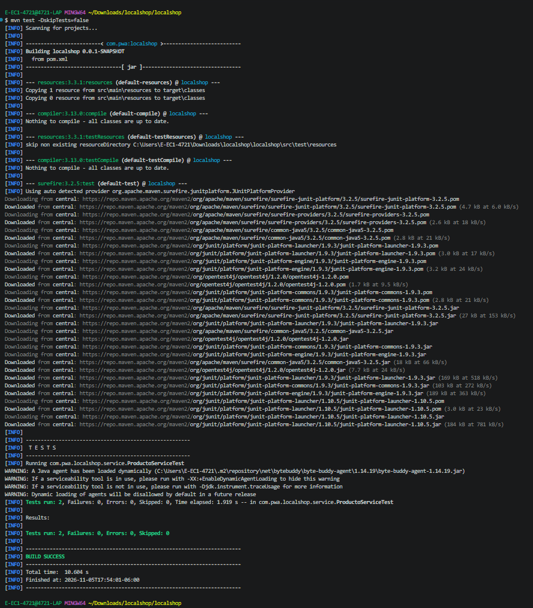

# 🧪 Práctica 5: Laboratorio de Pruebas 2 — Pruebas Unitarias en Spring Boot

[](https://openjdk.org/)
[](https://spring.io/projects/spring-boot)
[](https://junit.org/junit5/)
[](https://site.mockito.org/)
[](https://maven.apache.org/)

Repositorio de entrega para la práctica de pruebas unitarias sobre la capa de servicios en una arquitectura **Spring Boot**, aislando dependencias mediante **Mockito** y validando resultados con **JUnit 5** y **AssertJ**.

---

## 📌 Datos de la Asignatura y Práctica

* **Asignatura:** Aplicaciones Web Progresivas / Desarrollo Backend (`IDGS101`)
* **Unidad de Aprendizaje:** Pruebas de Software y Calidad de Componentes
* **Práctica:** `[Práctica-5] Laboratorio de Pruebas 2`
* **Modalidad:** En equipo
* **Integrantes:**
  * Luis Armando Baca Loya
  * *(Agregar aquí nombres de compañeros de equipo)*

---

## 🎯 Objetivo de la Práctica

Diseñar e implementar pruebas unitarias automatizadas con **JUnit 5** y **Mockito** para validar el funcionamiento de las operaciones de persistencia y recuperación de datos (`findAll` y `create/save`) en la capa de servicios (`ProductoService`), garantizando la independencia de la base de datos física mediante dobles de prueba (mocks).

---

## 🛠️ Tecnologías y Dependencias

| Herramienta / Librería | Versión / Rol | Descripción |
| :--- | :--- | :--- |
| **JDK** | Java 17 | Entorno de ejecución y compilación |
| **Spring Boot** | 3.3.x | Framework base de backend |
| **Spring Data JPA** | 3.x | Abstracción de persistencia |
| **H2 Database** | En memoria (Runtime) | Base de datos ligera para pruebas y arranque local |
| **spring-boot-starter-test** | Incluida | Agrupa JUnit Jupiter, Mockito, AssertJ y Hamcrest |
| **Apache Maven** | Gestor | Automatización de compilación y ciclo de vida |

---

## 📂 Arquitectura del Proyecto

```text
localshop/
├── pom.xml
├── docs/
│   └── screenshots/
│       └── test-execution.png       <-- Ubicación recomendada para la captura
├── src/
│   ├── main/
│   │   ├── java/com/pwa/localshop/
│   │   │   ├── LocalshopApplication.java
│   │   │   ├── controller/
│   │   │   │   └── ProductoController.java
│   │   │   ├── model/
│   │   │   │   └── Producto.java
│   │   │   ├── repository/
│   │   │   │   └── ProductoRepository.java
│   │   │   └── service/
│   │   │       └── ProductoService.java
│   │   └── resources/
│   │       └── application.properties
│   └── test/
│       └── java/com/pwa/localshop/
│           └── service/
│               └── ProductoServiceTest.java
```

---

## 🧪 Pruebas Unitarias Implementadas

Las pruebas se encuentran en `ProductoServiceTest.java` y siguen el patrón **Given-When-Then**:

### 1. `testFindAllProductos` (Prueba de recuperación)
* **Given (Dado):** Se simula que `productoRepository.findAll()` retorna una lista precargada con 2 entidades `Producto`.
* **When (Cuando):** Se ejecuta el método `productoService.findAll()`.
* **Then (Entonces):** 
  * Se valida con AssertJ que la colección devuelta no sea nula.
  * Se valida que el tamaño sea exactamente 2.
  * Se verifica con Mockito que `productoRepository.findAll()` haya sido invocado exactamente 1 vez.

### 2. `testCreateProducto` (Prueba de persistencia)
* **Given (Dado):** Se simula que `productoRepository.save(...)` persiste y retorna el objeto `Producto` configurado en el `@BeforeEach`.
* **When (Cuando):** Se ejecuta `productoService.save(producto)`.
* **Then (Entonces):**
  * Se valida que el objeto guardado no sea nulo.
  * Se valida que el atributo `nombre` corresponda al valor esperado ("Cafetera Espresso").
  * Se asegura que el `precio` sea mayor a 0.0.
  * Se comprueba la interacción con `verify(productoRepository, times(1)).save(...)`.

---

## 📸 Evidencia de Ejecución Exitosa

### Comando ejecutado en consola:
```bash
mvn test
```

### Captura de pantalla de la terminal:
> Guarda tu captura de pantalla en la carpeta `docs/screenshots/test-execution.png` (o en la raíz) para que se visualice automáticamente a continuación:



*(Si tu imagen tiene otro nombre o ruta, solo actualiza la línea anterior).*

---

### Salida literal de la consola:

```text
[INFO] -------------------------------------------------------
[INFO]  T E S T S
[INFO] -------------------------------------------------------
[INFO] Running com.pwa.localshop.service.ProductoServiceTest
[INFO] Tests run: 2, Failures: 0, Errors: 0, Skipped: 0, Time elapsed: 1.919 s -- in com.pwa.localshop.service.ProductoServiceTest
[INFO] 
[INFO] Results:
[INFO] 
[INFO] Tests run: 2, Failures: 0, Errors: 0, Skipped: 0
[INFO] 
[INFO] ------------------------------------------------------------------------
[INFO] BUILD SUCCESS
[INFO] ------------------------------------------------------------------------
```

---

## ✅ Cumplimiento de la Lista de Cotejo

| # | Criterio / Requerimiento | Cumple | Evidencia / Observación |
| :-: | :--- | :-: | :--- |
| **1** | Configuración del entorno (`spring-boot-starter-test` y JUnit 5) | **SÍ** | Configurado en `pom.xml` con scope `test`. |
| **2** | Prueba de `findAll` | **SÍ** | Simulación de repositorio y validación de 2 registros devueltos. |
| **3** | Prueba de `create` | **SÍ** | Validación de persistencia, retorno íntegro y aserciones de atributos. |
| **4** | Uso adecuado de Mockito (`@Mock`, `@InjectMocks`, AssertJ) | **SÍ** | MockitoExtension activo, repositorio aislado y aserciones BDD. |
| **5** | Ejecución exitosa | **SÍ** | `BUILD SUCCESS`, `Tests run: 2, Failures: 0, Errors: 0`. |